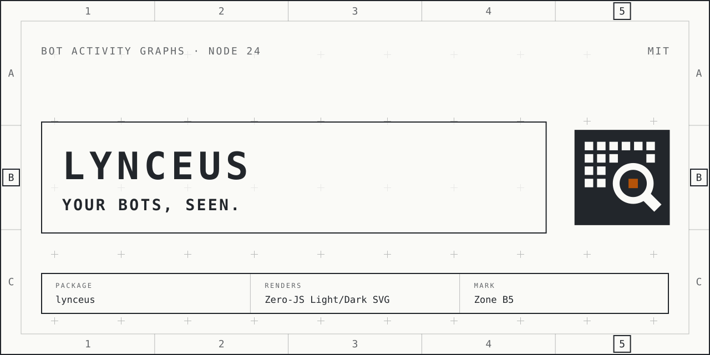
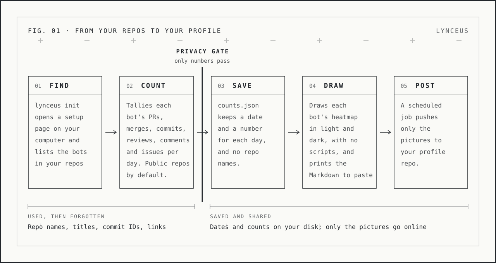

<p align="center">
  
</p>

# lynceus

**Your bots, seen.**

GitHub draws no contribution graph for a GitHub App or a `[bot]` account, and
a bot's work never shows on your own heatmap. `lynceus` finds the `[bot]`
accounts working in your or your organization's repositories, counts what each
did per day, and renders that as Light and Dark SVG heatmaps for a profile
README (`<owner>/<owner>` or `<owner>/.github`). It keeps only dates and
integers, and pushes only the SVGs.

A zero-dependency Node 24 CLI, plus a local Builder UI to set it up.
[Open the live demo](https://mephistopheles4.github.io/lynceus/) (static, with
synthetic data).

## How it works

<p align="center">
  
</p>

| Stage | Command | Runs on | What it reads | What it keeps |
|---|---|---|---|---|
| Find | `lynceus init` | Your machine; Builder UI on `127.0.0.1:4173` | GraphQL search over the last `26` or `52` weeks | `[bot]` slugs and an event estimate, then your `lynceus.json` |
| Count | `lynceus collect` | Your machine | GraphQL `search` and REST `/search/commits`: PRs opened, PRs merged, commits, reviews, comments, issues | Nothing yet: each event is bucketed to its UTC date in memory |
| Privacy gate | inside `collect` | Your machine | The day buckets | A closed schema: any key beyond dates, totals, streaks and display labels fails the run |
| Save | `lynceus collect` | Your machine | — | `counts.json`: UTC dates, integer totals, streaks |
| Draw | `lynceus render` | Your machine | `counts.json` and `lynceus.json` | Light and Dark SVGs, and the `<picture>` Markdown on `stdout` |
| Post | `lynceus schedule` | Task Scheduler, cron or GitHub Actions | The SVGs | One replaced orphan commit on `generated`, with `*.svg` only |

`lynceus build` runs count, save and draw in one step.

## What lands on your profile

- **One card or one per bot.** `layout: "unified"` draws every bot on one card;
  `"separate"` draws a Light and Dark pair for each.
- **Your labels and colours.** Each bot gets a display label and one of six
  ramps (`emerald`, `cobalt`, `amber`, `violet`, `rose`, `teal`).
- **Totals or just the grid.** `detail: "breakdown"` adds metric totals and
  current and best streaks; `"minimal"` keeps a count and the heatmap.
- **Light and Dark, picked by GitHub.** The `<picture>` embed follows the
  reader's `prefers-color-scheme`.
- **Nothing that runs.** No `<script>`, no external URL beyond the root
  `xmlns`, no inline `style=`, no event handlers: safe behind GitHub's Camo proxy.

## Commands

| Command | What it does |
|---|---|
| `lynceus init` | Opens the Builder UI to discover bots, set labels and ramps, preview Light and Dark, and download `lynceus.json`, SVGs or a refresh script |
| `lynceus collect` | Writes anonymous daily counts to `counts.json` |
| `lynceus render` | Renders Light and Dark SVGs from `counts.json` and prints the `<picture>` Markdown |
| `lynceus build` | `collect` and `render` in one step; writes `counts.json` only with `--counts-out` |
| `lynceus schedule` | Writes a hardened refresh script and how to register it |
| `lynceus --help` / `--version` | Help and version |

## Quick start

1. **Prerequisites.** **Node.js `>= 24.0.0`** (ESM, zero runtime or dev
   dependencies), and GitHub authentication for `collect`, `build` and live
   discovery in `init`, found in this order:
   1. the `GITHUB_TOKEN` environment variable,
   2. the `GH_TOKEN` environment variable,
   3. the GitHub CLI, signed in with `gh auth login` (`gh` is resolved only from
      absolute `PATH` directories).
2. **Install.** `npm install -g lynceus`, or run `npx lynceus`, or from a
   checkout `node bin/lynceus.mjs`.
3. **Set up.** Run `lynceus init` and pick your bots in the Builder UI. It saves
   `lynceus.json`.
4. **Build.** Write the SVGs and print the Markdown to paste into your profile
   README:

   ```sh
   lynceus build --config ./lynceus.json --out-dir ./agent-activity
   ```

5. **Keep it fresh.** Generate a refresh script for your platform:

   ```sh
   # Windows Task Scheduler (.ps1 saved outside your git repo)
   lynceus schedule --config ./lynceus.json --target task-scheduler --task-name LynceusProfileRefresh

   # POSIX cron (.sh saved outside your git repo with chmod 600)
   lynceus schedule --config ./lynceus.json --target cron

   # GitHub Actions workflow (.github/workflows/lynceus.yml — always --public-only)
   lynceus schedule --config ./lynceus.json --target actions --tool-ref <40-hex-commit-sha>
   # Or post-publish with an unscoped package pin:
   lynceus schedule --config ./lynceus.json --target actions --package-pin lynceus@0.1.0
   ```

> **Private activity cannot be taken back once pushed.** Lynceus counts public
> repositories unless you pass `--include-private`. With it, private activity
> is added into the daily totals. No private repository name, title, SHA or URL
> is ever stored or emitted, but once those SVGs are pushed to a public
> repository (such as `<owner>/<owner>`), the combined daily totals remain
> visible in public repository git history and cannot be retracted.

## Reference

<details>
<summary><strong>Privacy and security model</strong></summary>

- **Anonymous daily integer totals only (`counts.json`).** `counts.json`
  (schema v1) stores only UTC calendar dates (`days`), non-negative integer
  `totals`, `streaks`, `scope.mode` (`"public"` or `"public+private"`), and agent
  display metadata (`slug`, `label`, `ramp`). It **never** stores or emits
  repository names, issue or PR titles, URLs, commit SHAs, email addresses, or
  GraphQL node IDs.
- **Zero-JS, Camo-safe SVGs.** Generated SVGs contain no `<script>`, no external
  URLs (other than the single root `xmlns="http://www.w3.org/2000/svg"`), no
  inline `style=` attributes, and no event handlers. Light and Dark variants
  pair automatically in GitHub READMEs via `<picture>` and
  `prefers-color-scheme`.
- **Tokens stay in-process.** GitHub tokens are never written to disk, embedded
  in SVGs, exposed to browser storage, or passed to static demo bundles. Error
  messages and non-fatal warnings are scrubbed before output.
- **SVG-only orphan pushes.** `lynceus schedule` generates refresh scripts that
  push **only** `*.svg` files to a single replaced orphan commit on a dedicated
  branch (default: `generated`; `main`, `master`, `HEAD`, and `refs/*` are
  rejected) using `--force-with-lease` and UTC noreply git metadata.
  `counts.json` is never staged or pushed.

</details>

<details>
<summary><strong>Private repository activity (<code>--include-private</code>)</strong></summary>

Safety rules enforced by the CLI:

- **Public-only by default.** All commands default to public repositories
  (`is:public`).
- **Explicit CLI confirmation required.** If your `lynceus.json` sets
  `"includePrivate": true`, `collect`, `build`, and local `schedule`
  (`task-scheduler` / `cron`) require you to pass `--include-private` explicitly
  on the command line (or override with `--public-only`).
- **`init` resets it.** When `init` auto-loads an existing `lynceus.json`,
  `includePrivate` is reset to `false` in memory unless you pass
  `--include-private` on the CLI (or opt in inside the UI).
- **Mutual exclusion.** `--include-private` and `--public-only` cannot be
  combined (`exit 2`).
- **GitHub Actions restriction.** `--target actions` always enforces
  `--public-only` and rejects `--include-private` or private configs without
  `--public-only`.
- **Keep private configs and scripts out of public repos.** When using
  `--include-private`, store `lynceus.json` and your generated `.ps1`/`.sh`
  refresh script in a user-private directory outside your public profile
  repository.

</details>

<details>
<summary><strong>Running the stages separately</strong></summary>

`init` serves the Builder UI on `127.0.0.1:4173` by default, falling back to an
ephemeral port if `4173` is busy:

```sh
lynceus init
# Or specify config, port, or headless mode:
lynceus init --config ./lynceus.json --port 4173 --no-open
```

Collect and render as two steps:

```sh
# 1. Collect anonymous daily counts into ./counts.json
lynceus collect --config ./lynceus.json --out ./counts.json

# 2. Render Light/Dark SVGs from ./counts.json and print <picture> Markdown
lynceus render --counts ./counts.json --config ./lynceus.json --out-dir ./agent-activity
```

`render` also works without `lynceus.json` when you supply the layout and owner
flags:

```sh
lynceus render --counts ./counts.json --owner your-username --scope-type user \
  --layout separate --detail breakdown --mark-style squares --label-mode friendly \
  --branch generated --subpath agent-activity --markdown-base raw --out-dir ./agent-activity
```

</details>

<details>
<summary><strong>Configuration (<code>lynceus.json</code>)</strong></summary>

`lynceus.json` uses a closed schema (`schemaVersion: 1`):

```json
{
  "schemaVersion": 1,
  "owner": "your-username",
  "scopeType": "user",
  "includePrivate": false,
  "windowWeeks": 52,
  "layout": "unified",
  "detail": "breakdown",
  "markStyle": "squares",
  "labelMode": "friendly",
  "branch": "generated",
  "subpath": "agent-activity",
  "markdownBase": "raw",
  "metrics": {
    "prsOpened": true,
    "prsMerged": true,
    "commits": true,
    "reviews": true,
    "comments": true,
    "issues": true
  },
  "agents": [
    {
      "slug": "your-app[bot]",
      "label": "Your Agent",
      "ramp": "emerald"
    }
  ]
}
```

| Key | Values |
|---|---|
| `scopeType` | `"user"` (profile repo `<owner>/<owner>`) or `"org"` (profile repo `<owner>/.github`) |
| `windowWeeks` | `52` or `26` |
| `layout` | `"unified"` (single combined card) or `"separate"` (one Light/Dark SVG pair per bot) |
| `detail` | `"breakdown"` (metric totals and streaks) or `"minimal"` (compact count and heatmap) |
| `markStyle` | `"squares"` or `"magnitude"` |
| `labelMode` | `"friendly"` (display `label` + `[bot]` slug) or `"raw"` (`[bot]` slug only) |
| `ramp` | `"emerald"`, `"cobalt"`, `"amber"`, `"violet"`, `"rose"`, or `"teal"` |
| `agents` | `1` to `12` unique `[bot]` slugs |
| `metrics` | all 6 booleans present, at least one `true` |

</details>

<details>
<summary><strong>CLI flags, defaults and exit codes</strong></summary>

| Command | Flags |
| --- | --- |
| `lynceus` | `--help` (`-h`), `--version` (`-v`) |
| `lynceus [init]` | `[--config <path>]` `[--port <port>]` `[--no-open]` `[--include-private]` |
| `lynceus collect` | `[--config <path>]` `[--out <counts.json>]` `[--include-private]` `[--public-only]` `[--date <YYYY-MM-DD>]` `[--quiet]` |
| `lynceus render` | `[--counts <counts.json>]` `[--config <path>]` `[--out-dir <dir>]` `[--owner <slug>]` `[--scope-type <user\|org>]` `[--layout <unified\|separate>]` `[--detail <breakdown\|minimal>]` `[--mark-style <squares\|magnitude>]` `[--label-mode <friendly\|raw>]` `[--branch <name>]` `[--subpath <path>]` `[--markdown-base <raw\|relative>]` `[--quiet]` |
| `lynceus build` | `[--config <path>]` `[--out-dir <dir>]` `[--counts-out <path>]` `[--include-private]` `[--public-only]` `[--date <YYYY-MM-DD>]` `[--quiet]` |
| `lynceus schedule` | `[--config <path>]` `[--out-dir <dir>]` `[--script-path <path>]` `[--target <task-scheduler\|cron\|actions>]` `[--repo-dir <path>]` `[--owner <slug>]` `[--branch <name>]` `[--subpath <path>]` `[--include-private]` `[--public-only]` `[--tool-ref <40-hex-sha>]` `[--package-pin <spec>]` `[--git-name <name>]` `[--git-email <email>]` `[--task-name <name>]` |

**Defaults:** `--config ./lynceus.json`, `collect --out ./counts.json`,
`render --counts ./counts.json`, `--out-dir ./agent-activity`, `init --port 4173`,
`schedule --repo-dir . --task-name LynceusProfileRefresh`.

| Exit code | Meaning |
|---|---|
| `0` | Success |
| `2` | Usage, config validation, Camo safety, or `--include-private` gate error |
| `3` | Missing or rejected GitHub authentication |
| `4` | GitHub API, timeout, or rate-limit error |
| `5` | Filesystem confinement, symlink, or server port-bind error |

</details>

## Development

```sh
npm run check        # Verify zero-deps/hygiene contract, lint, tests, and Pages bundle
npm run lint         # Syntax-check all .mjs and .js files
npm test             # Run the Node test suite (node --test)
npm run build:pages  # Build static Lynceus demo bundle into dist-pages/
node scripts/brand.mjs  # Regenerate the README art in docs/brand/
```

## Contributing & Security

- Read [`CONTRIBUTING.md`](CONTRIBUTING.md) before opening a pull request.
- Report security issues privately under [`SECURITY.md`](SECURITY.md) (do not open a public issue).
- Participation is governed by the [Code of Conduct](CODE_OF_CONDUCT.md).

Licensed under the [MIT License](LICENSE).
