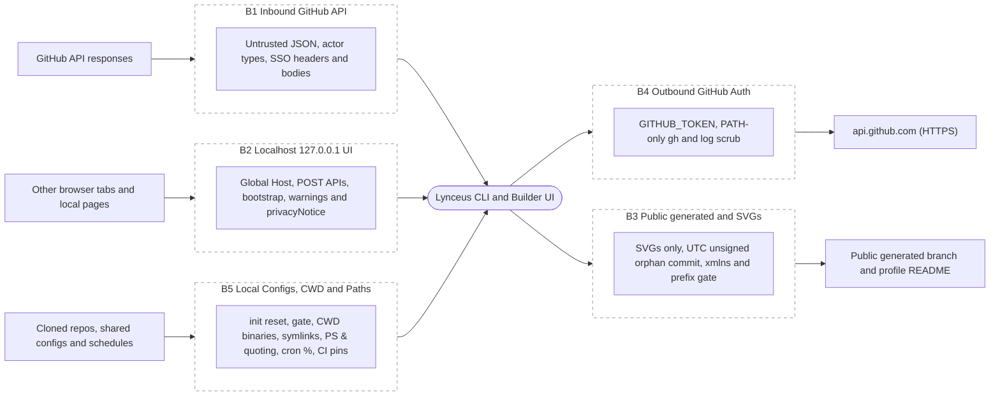

# Threat Model: Lynceus V1 (`mephistopheles4/lynceus`, Revision 5)

Read the boundaries first. Place each finding on one: where something comes in from outside, or where an act goes out. What starts and ends on the machine (your own workstation running Lynceus, or a local sandbox run on it) is the machine's, and no finding; what came in from outside stays outside input wherever it sits. Name the control that holds the boundary against the path, with when it doesn't hold; if one does, add nothing. Check the residual against the accepted classes, and bring the owner everything `review.md` step 5 lists (`security?` rows, new boundaries, uncovered residuals, and weakened or removed controls).

## Boundaries



### B1 Inbound GitHub API

**Crosses:** Untrusted external JSON from public/private GitHub issues, pull requests, reviews, comments, commits, user profiles, GraphQL `errors[]`, and HTTP response headers (`Retry-After`, `X-GitHub-SSO`, redirects).

**Controls:**

* **Collector defaults and strict schema gates:** Explicit `is:public` query qualifier unless strict boolean `includePrivate === true` (`collect`/`build`/`schedule` explicit opt-in or UI boolean); strict `owner`, `scopeType`, and `botSlug` validation at entrypoints; GraphQL search queries bound solely via `$q: String!` + `$after` and REST params via `URLSearchParams`; strict `author?.__typename === 'Bot'` attribution check; `assertValidDiscoverResult` and `assertStrictCountsOnly` closed-schema allowlists; node IDs and SHAs discarded in memory immediately. *Does not hold:* once the user opts into `--include-private`, aggregate private daily integers cross into `counts.json`; depends on GitHub Search honoring `is:public` and token permissions (checked heuristically via deduplicated `X-OAuth-Scopes` caveat).
* **No-redirect transport and complete error/header scrubbing:** Hardcoded `https://api.github.com/*` origins with `redirect: 'error'` and `15 s` timeout; `403` with `X-GitHub-SSO` fails immediately (`0` retries, `AUTH_FORBIDDEN`) without reading or copying the header value; raw HTTP error bodies, `X-GitHub-SSO` values, GraphQL `errors[].message` / `path`, and `undici` `err.cause` chains are discarded rather than propagated; `redactSecrets()` scrubs any token pattern from all stderr and error paths. *Does not hold:* against malicious API responses returning syntactically valid fake bot events on public PRs where a `[bot]` participated.

**Residual:** GitHub search indexing and default-branch limits.

### B2 Localhost 127.0.0.1 UI

**Crosses:** Browser and local HTTP requests (`GET /`, static assets/renderer modules, `POST /api/*`), HTTP caching, DOM rendering, `--config` hydration, `52w`/`26w` preview queries, and UI-to-server actions.

**Controls:**

* **Global** `Host` **guard, method allowlist & all-**`POST` **API pipeline:** Bind strictly to `127.0.0.1`; enforce exact `Host === 127.0.0.1:<port>` (`400`) BEFORE dispatch on ALL requests (`GET` static routes as well as `POST /api/*`); reject unsupported HTTP methods (`405`, zero CORS); exact static `GET` allowlist with explicit `Content-Type` (`text/javascript; charset=utf-8` for JS/MJS, `image/x-icon` for `favicon.ico`); all `/api/*` routes require `POST` JSON with exact `Origin: http://127.0.0.1:<port>`, `Sec-Fetch-Site: same-origin` (when sent), per-session 256-bit `Bearer` `sessionToken` (`timingSafeEqual` on SHA-256), `Content-Type: application/json`, strict boolean `includePrivate`/`live`, and `<= 32 KB` body; zero HTTP disk-write endpoints; opaque JSON errors.
* **Browser storage, cache, bootstrap & DOM isolation:** `Cache-Control: no-store`, `X-Content-Type-Options: nosniff`, `Referrer-Policy: no-referrer`, and `Content-Security-Policy: frame-ancestors 'none'` on every response (including errors); per-request cryptographic `nonce` (`16 B`) + `form-action 'none'` on `GET /`; static `<!-- LYNCEUS_BOOTSTRAP -->` marker replaced in RAM on localhost only to hand `sessionToken` into `app.js` closure and delete itself (`undefined` → zero `/api/*` calls in `dist-pages/`); `--config` loaded exclusively via authenticated `POST /api/config` with `includePrivate` forced `false` unless `init --include-private` was passed; zero `innerHTML` (``), zero inline `style=`, zero `localStorage`; `Schedule` tab accepts optional `scriptPath`/`toolRef`/`packagePin` (rejecting `toolRef`+`packagePin` conflict or `scriptPath` on `actions` with `400`), keeps `POST /api/schedule` error clearing isolated from valid Workbench SVGs, provides `Blob` script download, and renders `privacyNotice` + `warnings`/fatal errors cleanly via `textContent`. *Does not hold:* against a compromised same-UID browser extension or process inspecting OS memory or authenticated local tab DOM.

**Residual:** Same-UID local compromise.

### B3 Public generated branch and SVGs

**Crosses:** Exported Light/Dark SVGs, README `<picture>` embeds, and scheduled orphan commits pushed to public `mephistopheles4/mephistopheles4` `generated` branch and served via GitHub camo proxy; static `dist-pages/` bundle.

**Controls:**

* **Sanitized SVG & Markdown gates:** `stripControlChars` (C0/C1, `LRM`/`RLM`/`ALM`, BiDi overrides, `!isWellFormed()` unpaired UTF-16 surrogates) + `escapeXml` (`&apos;`, never `&#39;`) across every text node and every Markdown attribute (`alt`, `src`, `srcset`); frozen `palettes.mjs` (`Object.hasOwn`); quote-aware `assertCamoSafeSvg` requiring single root `<svg xmlns="http://www.w3.org/2000/svg"`, blocking secondary `xmlns:` namespaces (`/\bxmlns:/i`) and optional-prefix active elements (`script`, `foreignObject`, `style`, `use`, `image`, `animate*`, `set`, `discard`, `feImage`, `iframe`, `embed`, `object`, `a`), `href=`, attribute `on*=`, inline `style=`, `data:`, `vbscript:`, semicolon-optional `&#` entities, and `/https?:\/\//i` outside the stripped single root `xmlns` attribute while preserving harmless `<text>` (`"button=1"`).
* **Zero-counts / zero-PII unsigned orphan pushes & subpath scan:** `branch` rejects `main`/`master`/`HEAD` and `refs/`/`heads/`/`tags/`/`remotes/` prefixes; `subpath` rejects dot-segments; snippets inspect remote default head via `git ls-remote --symref origin HEAD` and force-replace strictly `refs/heads/<branch>` via `--force-with-lease` committing **SVGs only** (never `counts.json`), authored unsigned (`-c commit.gpgsign=false`) in UTC with `lynceus-bot` / `users.noreply.github.com`; `--target actions` restricts `on:` triggers to `schedule:` / `workflow_dispatch:` and sets `persist-credentials: false`; `build-pages.mjs` fails non-zero if `dist-pages/` contains local configs, `counts.json`, local paths, or `127.0.0.1`/`api.github.com`. *Does not hold:* daily total counts shown on public SVGs inherently remain observable on calendar day D when `--include-private` is active.

**Residual:** Daily-count correlation under opt-in private mode; User-chosen GitHub Actions token scope.

### B4 Outbound GitHub Auth

**Crosses:** Authenticated `Authorization: Bearer <token>` HTTPS requests and `gh auth token` subprocess invocation.

**Controls:**

* **Direct HTTPS, safe binary lookup, & buffer scrub:** Tokens checked (`GITHUB_TOKEN`, `GH_TOKEN`, rejecting `\r`/`\n`/control chars); `gh` (`gh.exe` on `win32`) resolved strictly from non-empty absolute `process.env.PATH` entries via shared `resolveSafeExecutable` (never `cwd` on Windows) and spawned with `shell: false`, `cwd: os.tmpdir()`, `stdio: ['ignore', 'pipe', 'pipe']`; `.stdout`/`.stderr`/`.output` stripped on error; HTTPS `redirect: 'error'` to hardcoded `api.github.com` only; central `redactSecrets()`. *Does not hold:* against malicious software already running under the same OS UID.

**Residual:** Same-UID local compromise.

### B5 Local configs, CWD and paths

**Crosses:** Untrusted cloned repository files (`./gh.exe`, `./rundll32.exe`, symlinks, `./lynceus.json`, `counts.json`), CLI flags/env, and unattended scheduled/CI execution.

**Controls:**

* **Explicit private opt-in, safe OS spawns & bounded path/temp confinement:** Closed `lynceus.json` (`src/collector/config.mjs`) and strict `counts.json` validation (`render --counts` gated by `readBoundedJsonFile` + `assertStrictCountsOnly`); auto-loaded `./lynceus.json` or explicit `--config <path>` with `includePrivate: true` requires explicit CLI `--include-private` on `collect`, `build`, AND local `schedule` (`--public-only` conflict exits `2`; `--target actions` rejects private configs), AND resets `includePrivate` to `false` on `lynceus init` auto-load unless CLI `--include-private` was passed; browser launch uses validated `SystemRoot\System32\rundll32.exe` (`win32`) or `PATH`-only opener (`darwin`/`linux`) with `shell: false` and `cwd: os.tmpdir()`; `fs-safe.mjs` anchors walks at `realpathSync(cwd)` / `realpathSync(tmpdir())` (handling macOS `/var`/`/tmp` cleanly) before segment `lstatSync` symlink checks (and parent `mkdirSync` in `writeVerifiedJson`) + `readBoundedJsonFile` (no symlink/non-file reads or raw `JSON.parse` excerpts) + `O_EXCL` (`0o600` private `counts.json`, `0o644` SVGs); scheduler snippets reject leading `-` on raw path flags, resolve local paths (`--repo-dir`, `--config`, explicit `--out-dir`, `--script-path`/default, `<resolved-bin-path>`) via `path.resolve()` **before** validating C0/C1/YAML line breaks (`\u0085`/`\u2028`/`\u2029`), PowerShell Unicode quotes (`\u2018`–`\u201E`), shell metacharacters, trailing `\` on `<abs-ps1-path>`, and `cron` `%`, default `.ps1`/`.sh` to a non-repo non-temp private location (sibling to non-repo `--config` else user state dir, rejecting `--repo-dir` and `os.tmpdir()`/`/tmp`/`/var/tmp`), require `chmod 600` (`.sh`) / user-private ACLs (`.ps1`), pin Task Scheduler `-Argument '-NoProfile -NonInteractive -ExecutionPolicy Bypass -File "<abs-ps1-path>"'`, use `& 'node'` inside `.ps1`, emit `%`-free `.sh` with `--` path operands (cleaning only script-created temp dirs), enforce closed POSIX relative `/^(?!-)[a-zA-Z0-9._-]+(?:\/[a-zA-Z0-9._-]+)*$/` on `actions` `--config`/`--out-dir` with `--` operands, YAML single-quote `env:` vars, check out `mephistopheles4/lynceus` via 40-hex `--tool-ref` / pinned Actions SHAs (`persist-credentials: false`, `node-version: '24'`, failing pre-release if unset), lock `--package-pin` strictly unscoped to `/^lynceus@[0-9]+\.[0-9]+\.[0-9]+(?:-[a-zA-Z0-9.-]+)?$/`, and reject `--tool-ref` + `--package-pin` conflict. *Does not hold:* against an intentionally unsafe `--out-dir` explicitly chosen by the user or same-UID OS compromise.

**Residual:** Same-UID local compromise; User-chosen GitHub Actions token scope.

## Scope

**In scope:** The five trust boundaries (`B1`–`B5`) above. Shared configs, cloned repos, API responses, and third-party browser origins stay outside inputs even when read locally.

**Out of scope:** The Machine itself (workstation OS user account, local disk encryption, antivirus), malicious same-UID programs already running on the workstation, V2 Linear OAuth/collector scope, and multi-tenant hosted deployment of `builder-ui` (GitHub Pages hosts only static `SYNTHETIC DEMO DATA`).

**Root of trust:** The user's GitHub account, local OS user account, and explicit CLI confirmations gating private scope or public branch/README writes.

## Residual risk

```mermaid
quadrantChart
  title Residual risk (likelihood vs impact after V1 revision 5 controls)
  x-axis Low likelihood --> High likelihood
  y-axis Low impact --> High impact
  quadrant-1 Watch
  quadrant-2 Guard closely
  quadrant-3 Accept
  quadrant-4 Keep checking
  Same-UID local compromise: [0.15, 0.90]
  Daily-count correlation (opt-in private): [0.75, 0.40]
  User-chosen Actions token scope: [0.30, 0.75]
  GitHub search index and default-branch limits: [0.60, 0.25]
```

## Accepted threat classes

Each class covers only what its sentence names; nothing under Open gaps is accepted into a class:

* **Daily-count correlation under opt-in private mode.** Publishing anonymous total daily integer counts under explicit `--include-private` reveals that aggregate bot activity occurred on calendar day D without revealing repository names, titles, or URLs.
* **Same-UID local compromise.** Any program, script, or browser extension executing under the same OS user account can directly inspect `gh` credentials, `GITHUB_TOKEN`, or loopback UI state.
* **GitHub search indexing and default-branch limits.** Default-branch `/search/commits` excludes feature-branch commits, and single-day bursts past GitHub's `1,000`-result cap truncate at `1,000` with a privacy-safe warning.
* **User-chosen GitHub Actions token scope.** When a user rejects local scheduling and supplies their own token in a public repository Actions workflow, credential scoping sits outside Lynceus's runtime control.

## Open gaps

* Spec Revision 5 closes all `Design round 2, final` security and data findings across `B2` and `B5` (schedule script paths/permissions, post-`path.resolve()` validation, `-Argument` quoting, `--config`/`--out-dir` guards, strictly unscoped `--package-pin`, and `Schedule` UI conflict/error scoping) and awaits scoped `Design further read` verification (`adversarial-lens` + `data-lens`) followed by mandatory Test-stage diff review on implementation code.

Signed: mephistos-euphorion